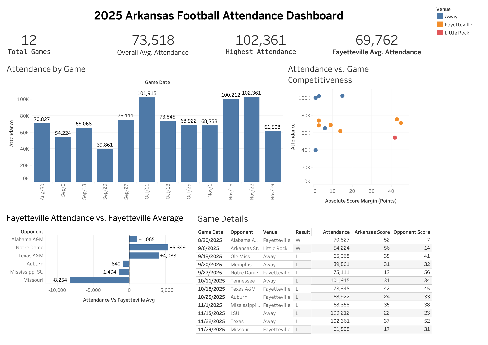

# Arkansas Football Analytics

An end-to-end analytics project that transforms public Arkansas football data into a validated Snowflake reporting layer and Tableau dashboard.

**Tech:** Python, pandas, BeautifulSoup, pdfplumber, SQL, Snowflake, Tableau

## Overview

This project builds a simple analytics pipeline for the completed 2025 Arkansas football season:

**Arkansas Athletics → Python → CSV → Snowflake → SQL → Tableau**

Python scrapes the official Arkansas Athletics football statistics page, discovers the 12 individual game report PDFs, downloads each report in memory, and extracts game-level information from the first page.

The resulting dataset contains one row per game and includes attendance, opponent, location, stadium, result, scores, kickoff time, and source URL.

## Data Pipeline

```text
Arkansas Athletics stats page
        ↓
12 official game report PDFs
        ↓
Python web scraping
        ↓
In-memory PDF parsing
        ↓
football_games_2025.csv
        ↓
Snowflake
        ↓
SQL validation + analytics view
        ↓
Tableau
```

The source PDFs are processed directly in memory and are not stored locally.

## Dataset

The processed dataset contains 12 games from the 2025 Arkansas football season.

| Field | Description |
| --- | --- |
| `season` | Football season |
| `game_date` | Date of the game |
| `opponent` | Arkansas opponent |
| `location_type` | HOME or AWAY |
| `arkansas_score` | Arkansas final score |
| `opponent_score` | Opponent final score |
| `result` | Win or loss |
| `site` | Game city and state |
| `stadium` | Stadium name |
| `attendance` | Reported attendance |
| `kickoff_time` | Local kickoff time |
| `source_url` | Official Arkansas game report |

## What I Built

- Scraped the official Arkansas Athletics statistics page with Python and BeautifulSoup
- Discovered the 12 individual 2025 game-report PDFs automatically
- Downloaded and parsed each PDF in memory using `requests`, `BytesIO`, and `pdfplumber`
- Extracted and standardized game dates, opponents, scores, results, venues, attendance, and kickoff times
- Generated a clean 12-row CSV with pandas
- Loaded the processed dataset into Snowflake
- Added SQL checks for row counts, duplicate games, and invalid attendance values
- Created a reporting-ready Snowflake view with score-margin, venue-context, and attendance-benchmarking fields
- Connected Tableau directly to the Snowflake analytical view
- Built a one-page attendance dashboard for the complete 2025 season

## Data Validation

The Snowflake validation layer checks that:

```text
Expected games       12
Duplicate games      0
Invalid attendance   0
```

Games are uniquely identified using game date and opponent.

## Snowflake Analytics Layer

The base table is:

```text
ARKANSAS_ATHLETICS.ANALYTICS.FOOTBALL_GAMES
````

The Tableau reporting view is:

```text
ARKANSAS_ATHLETICS.ANALYTICS.V_FOOTBALL_ATTENDANCE
```

The view exposes the reporting fields needed by Tableau and adds analytical features for:

* Score margin
* Absolute score margin
* Venue context: Fayetteville, Little Rock, or Away
* Score-margin bands
* Attendance relative to the Fayetteville average

These fields support deeper attendance analysis without changing the underlying data pipeline.

## Dashboard

### 2025 Arkansas Football Attendance Dashboard



The Tableau dashboard summarizes the full 2025 season with:

- 12 total games
- 73,518 overall average attendance
- 102,361 highest attendance
- 69,762 average Fayetteville attendance
- Attendance by game
- Attendance by venue context
- Attendance versus absolute score margin
- Fayetteville attendance relative to the Fayetteville average
- Game-level details including venue, scores, results, and attendance

## Analysis Findings

- Fayetteville averaged 69,762 attendees across six games.
- Notre Dame had the largest positive deviation from the Fayetteville average at +5,349, followed by Texas A&M at +4,083.
- Missouri had the largest negative deviation from the Fayetteville average at -8,254.
- Away games averaged 81,883 attendees, reflecting Arkansas playing several games in large-capacity road venues.
- Attendance did not show a clear descriptive relationship with final score margin across the 12-game season.

Because the dataset contains only one season and 12 games, these findings are descriptive rather than causal.

## Project Structure

```text
arkansas-athletics-analytics/
│
├── README.md
├── requirements.txt
├── .gitignore
│
├── data/
│   └── processed/
│       └── .gitkeep
│
├── dashboard/
│   └── 2025_arkansas_football_attendance.png
│
├── src/
│   └── build_dataset.py
│
└── sql/
    ├── create_table.sql
    ├── validate.sql
    └── analytics.sql
```

## Build the Dataset

Create and activate a Python environment, install the dependencies, and run:

```bash
pip install -r requirements.txt
python src/build_dataset.py
```

The script creates:

```text
data/processed/football_games_2025.csv
```

The generated CSV contains all 12 games and can then be loaded into the Snowflake `FOOTBALL_GAMES` table.

## SQL Workflow

The SQL files are intentionally small and separated by responsibility:

```text
create_table.sql
    Creates the Snowflake database, schema, and football table

validate.sql
    Checks row count, duplicates, attendance validity, and loaded records

analytics.sql
    Creates the reporting view consumed by Tableau
```

## Current Status

**v0.2 complete.**

The full pipeline is working end to end:

```text
Public Arkansas data
→ Python scraping
→ PDF extraction
→ CSV
→ Snowflake
→ SQL validation
→ analytical view
→ Tableau dashboard
```
